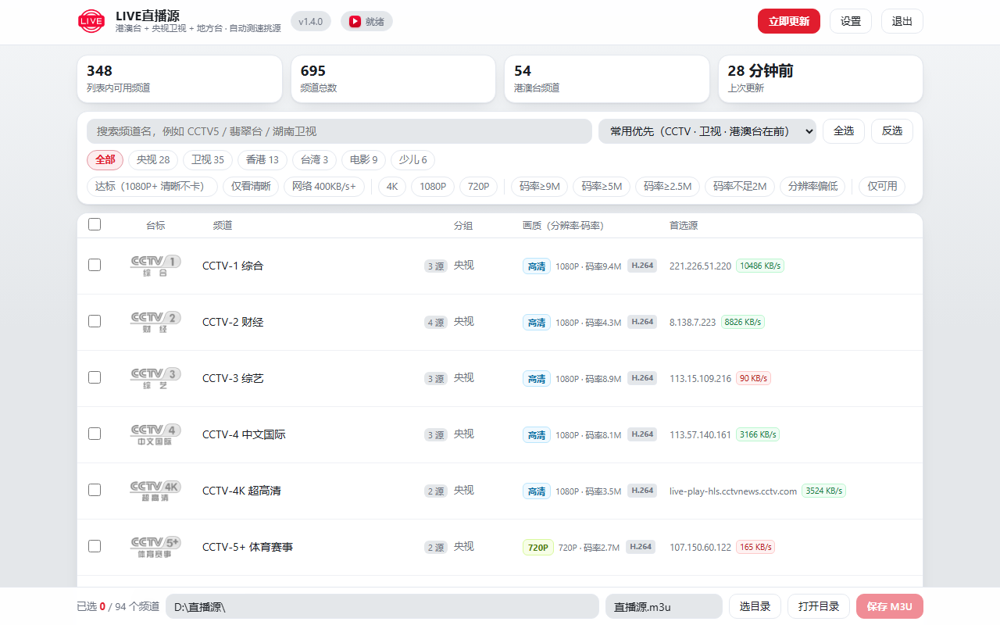

<div align="center">


<h1>LIVE直播源</h1>

<a href="https://github.com/kele551/LiveIPTV/releases" title="点击去下载（GitHub 合计 · 实时）"></a>
<a href="https://github.com/kele551/LiveIPTV" title="浏览量 · 实时（hits.sh）"></a>

<a href="https://github.com/kele551/LiveIPTV/blob/main/LICENSE"></a>

<a href="https://github.com/kele551/LiveIPTV/releases"></a>


<a href="https://github.com/kele551/LiveIPTV/stargazers"></a>
<a href="https://github.com/kele551/LiveIPTV/network/members"></a>
<a href="https://github.com/kele551"></a>


<a href="https://github.com/kele551/LiveIPTV/releases"></a>
<a href="https://github.com/kele551/LiveIPTV"></a>
<a href="https://github.com/kele551/LiveIPTV/issues"></a>
<a href="#支持项目"></a>

<p>📺 <b>直播源整理与可用性检测工具</b>　·　一键跑出一条自己能播的 M3U</p>
<p>作者 <b>海风（kele551）</b>　·　<a href="https://github.com/kele551/LiveIPTV">GitHub</a>　·　<a href="docs/COMPLIANCE.md">合规声明</a></p>
</div>

<details>
<summary>📊 <b>仓库数据一览</b>（点击展开）</summary>

<p align="center">


<a href="https://github.com/kele551/LiveIPTV/issues"></a>


<a href="https://github.com/kele551/LiveIPTV/blob/main/docs/CONTRIBUTING.md"></a>
</p>

</details>

---

## 这是什么

网上的直播源列表有很多，但**大多已经失效**：一个 m3u 里几十上百条，能播的可能只有几条，还得一条条去试。

这个小工具就干一件事：**把若干个公开的直播源列表抓下来，合并去重，实测哪些真的能播、画质到底多少，然后挑出最好的一条，导出成一个干净的 M3U**。导出的文件丢给 PotPlayer / VLC / IPTV 播放器 / 电视盒子都能直接用。

它自己**不提供、不存储、不转发任何直播内容**，只是把公开可访问的链接整理一遍、测一测（见 [合规声明](docs/COMPLIANCE.md)）。

> ⚠️ **用之前请看清楚这三句**
>
> 1. 本程序**不含任何节目内容**，只整理别人公开发布的链接；能不能播、内容是否合规，取决于你所在地区**和那些来源本身**。
> 2. 它**不解除任何付费、加密、鉴权限制**，也不提供"看某个频道"的服务——它只回答"这条链接此刻通不通、码率多少"。
> 3. 请自行确认当地法律法规与来源授权，**仅供个人自用**；整理结果不要用于公开播放、转播、再分发或售卖。如果不确定某个来源，直接在「设置 → 数据源」里关掉它（可以全部关掉，只用你自己的列表）。

---

## 三步上手

| 步骤 | 做什么 |
|---|---|
| **① 下载** | 去 [Releases](https://github.com/kele551/LiveIPTV/releases) 拿 `LIVE直播源.exe`，双击即可（单文件，免安装） |
| **② 更新** | 首次启动会自动跑一次体检；浏览器自动打开控制台 `http://127.0.0.1:8899` |
| **③ 导出** | 勾选想要的频道（或点「全选」）→ 点「保存 M3U」→ 把生成的 `直播源.m3u` 拖进播放器 |

下次打开直接用上次的结果（默认每 6 小时自动更新一次，可关）。

---

## 它到底做了什么

```
抓取 9 个公开源  →  按频道名合并去重  →  按源实测可用率排序
      ↓                                          ↓
 每个地址只测一次（去重）  →  连通性 + 是否返回网页  →  拉一段真实分片测速
      ↓                                          ↓
 每个频道挑一条最好的（画质优先、再看速度）  →  写 M3U（UTF-8 BOM，播放器不挑）
```

几个关键点：

- **同一地址只测一次**。不同源里大量重复地址，去重后要探测的数量能少一半以上。
- **按源的可信度排序**。先抽样 20 条算出每个源「大概有几成能播」，能播的源优先用，不行的源只留一条兜底。
- **上次在用的地址优先复测**。日常更新只复测上一轮真能播的那些地址，其余频道没有可播源时才去探新地址 —— 所以第二次以后的更新明显更快。
- **会认「假直播」**。有些地址连得上，但返回的其实是频道网页/中转页，这类一律判失效（也顺手记下来，下次不再访问）。
- **画质是解析视频流实测出来的**（v1.4.0 起）。直接解 TS 分片里 H.264 / HEVC 的 SPS、fMP4 的 `moov`、
  MPEG-2 的序列头，拿到**真实像素宽高**，再按分片字节数 ÷ 时长算**真实码率**；不是拿主清单里标称的
  `RESOLUTION` 猜，也不看频道名。实测覆盖率约 97%。
- **判定用两条**（用户实测口径）：分辨率 ≥1080P **且** 码率 ≥2 Mbps 才算清晰；下载吞吐 ≥400 KB/s 才算不卡。
  只测到一项时会标出缺的那项（"低码率" / "分辨率低"），点开能看到具体数值。
- **台标自带离线库**：随包 316 张（10.5 MB），第一次打开就有图，不用等从 GitHub 拉；透明的白字台标
  自动垫深色底，央视那批不会再"白字压白底看不见"。

---

## 界面

<p align="center"></p>

控制台就一页：

- 顶部：状态、进度、「立即更新」「设置」「退出」
- 四个数字：可用频道 / 在线直播源 / 港澳台 / 上次更新
- 中间：搜索、按分组筛（央视 / 卫视 / 港澳台 / 地方台 …）、按画质筛（4K / 1080P / 高清 / 仅港澳台 / 仅可用）
- 底部：已选数量、保存目录、文件名、「保存 M3U」「打开目录」

快捷键：`Ctrl+S` 保存、`Ctrl+F` 搜索、`Esc` 关弹窗。

右下角托盘图标：左键打开控制台，右键菜单有「打开控制台 / 立即更新频道 / 打开 M3U 所在文件夹 / 退出程序」；每次更新完会弹一条气泡告诉你结果。

---

## 数据源与实测可信度

内置 9 类公开源，默认只开下面这些（可用率是 2026-10-19 在本机抽样 20 条测的，会随网络和时间变化）：

| 源 | 覆盖 | 抽样可用 | 默认 |
|---|---|---|---|
| CCSH·平台源 `live_platforms.m3u` | 央视、卫视、港澳台、地方台 | 14/20 | ✅ |
| ChinaIPTV·自动更新 | 央视、卫视为主 | 10/20 | ✅ |
| CCSH·全量源 `live.m3u` | 同上，条目更多 | 8/20 | ✅ |
| Guovin·IPTV-API | 国内为主 | 6/20 | ✅ |
| iptv-org（中国 / 香港 / 台湾 / 澳门） | 境外整理的国内与港澳台 | 5/20、2/20、1/20、0/10 | ✅ |
| YanG·Gather | 国内聚合 | 5/20 | ✅ |
| kelvin（旧列表） | 香港 | 实测 0/38 | ❌ 默认关 |
| epg.pw（港/澳/台） | 港澳台 | 实测 0/135 | ❌ 默认关 |

> epg.pw 那几份列表里的流都指向同一个中转域名，本机连不上，所以默认关掉；想试可以在「设置 → 数据源」里重新打开。
> 抓取时会自动走 `jsdelivr` / `gh-proxy` 这类**公开 CDN 镜像**（原地址连不上时才会用），你也可以自己换。

---

## 设置里能改什么

| 分组 | 项 |
|---|---|
| 更新 | 自动更新间隔、每个频道保留几条备用、EPG 地址、保存位置、是否保留标清、启动时是否打开网页 |
| 程序 | 托盘图标、开机自启、计划任务（后台定时更新）、检查新版本、**必须校验签名**、自动下载新版本、升级源地址、检查间隔 |
| 数据源 | 每个源的开关、状态点、抓到的条数、抽样可用率 |

「计划任务」注册的是 `LIVE直播源自动更新`，用它可以在不开窗口的情况下定时跑一次（托盘和计划任务二选一，一般用托盘就够了）。

---

## 升级与签名

- 升级源是一份 `version.json` + 一份 `version.json.sig`。
- 程序内置 **Ed25519 公钥**，每次检查更新都会验签；**签名对不上或没有签名，一律拒绝升级**（可在设置里关掉，但不建议）。
- 下载完的新版本还会再核对 `sha256` 和字节数，三样都过才提示你替换。
- 因为程序是单文件 exe、运行时无法覆盖自己，新版本会下载到数据目录，提示你手动替换（或按提示操作）。

私钥不随仓库分发，签名流程见 [CODE_SIGNING_POLICY.md](docs/CODE_SIGNING_POLICY.md)。

---

## 常见问题

<details><summary><b>导出的 m3u 播放器不认？</b></summary>

文件是 UTF-8 带 BOM 的 `#EXTM3U`，PotPlayer、VLC、MX Player、Kodi、各类 IPTV 盒子都能直接读；如果播放器要求 http 链接，可以把文件放到本地 http 服务再填地址。
</details>

<details><summary><b>为什么有些频道没出现？</b></summary>

只输出「实测能拉出画面」的频道。判失效的三种情况：连不上、返回的是网页、能连上但拉不到数据。想放宽可以把「备用源数」调大，或在设置里关掉「保留标清」的限制。
</details>

<details><summary><b>为什么更新有时候要一两分钟？</b></summary>

第一轮要把几百上千个地址都测一遍；之后是增量更新，只复测上一轮能用的地址，一般快得多。也可以在设置里调低「并发探测数」、调小「备用源数」来缩短时间。
</details>

<details><summary><b>杀软报毒？</b></summary>

单文件 Python 打包的 exe 常被启发式误报。程序**只做两件事**：访问你启用的那些公开列表地址、把结果写进自己的数据目录 `%APPDATA%\LIVE直播源`。源码完全公开，可自行 `pyinstaller` 编译。
</details>

<details><summary><b>端口被占用？</b></summary>

默认 8899，被占会自动往后找 10 个；地址会打印在日志和数据目录里。
</details>

---

## 从源码运行

```bash
# 需要 Python 3.9+，只用标准库，不用装任何第三方包
python LIVE直播源.py              # 打开控制台（默认 http://127.0.0.1:8899）
python LIVE直播源.py --once       # 只更新一次就退出（适合计划任务）
python LIVE直播源.py --no-tray --no-browser --port 9000
```

打包：

```bash
python tools/build.py             # 产物在 builds/v<版本>/LIVE直播源.exe
python tools/preflight_release.py # 发版前自检（版本、签名、文档、红线词…）
```

数据目录：默认 `%APPDATA%\LIVE直播源`；设环境变量 `LIVE_DATA` 可以指到别处（便携 / 测试用）。

---

## 合规与免责

- 程序**不含任何直播内容**，不存储、不转发、不二次分发；只整理公开可访问的链接并做可用性测试。
- 所有频道、台标、节目内容的权利归各自权利人；本工具与任何电视台、平台、运营商**没有隶属关系**，也不代表其认可。
- 内容来自第三方公开列表，其合法性、稳定性、画质不由本工具保证；请遵守所在地法律法规，仅作个人学习与自用。
- 权利人若认为某个来源不宜被整理，可通过 [Issues](https://github.com/kele551/LiveIPTV/issues) 告知，我会把该来源从默认列表里移除。

完整说明见 [COMPLIANCE.md](docs/COMPLIANCE.md)。

## 第三方组件与许可

**零第三方依赖**：只用 Python 标准库（`http.server`、`urllib`、`concurrent.futures`、`ctypes` 等）。
Ed25519 验签为自行实现的 `_ed25519.py`（RFC 8032 参考实现思路，MIT）。
本项目以 [MIT](LICENSE) 许可发布，Copyright (C) 2026 HaiFeng (kele551)。

## 支持项目

如果它帮你省了点折腾时间，可以请我喝杯咖啡 ☕ —— 完全自愿，不影响任何功能。

<p align="center"></p>

---

<p align="center"><sub>作者 <b>海风（kele551）</b>　·　<a href="https://github.com/kele551/LiveIPTV">github.com/kele551/LiveIPTV</a></sub></p>
